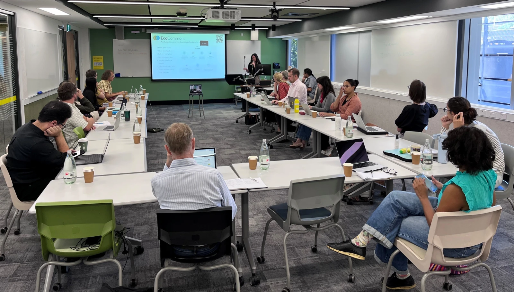

Community engagement activities have commenced and are progressing according to the [Community Building and Engagement Strategy](/plans.qmd#communication-and-engagement-plan). 

[Two co-design workshops](/workshops.qmd) were delivered during 2026 to inform project planning and technical development. 

The project has established a public website and communication channels to support dissemination of project outputs and engagement opportunities. 

A [symposium](/event-info/ESA-Symposium.qmd) involving project partners from UNSW, University of Melbourne, QUT and JCU has been accepted at the Ecological Society of Australia conference, while project presentations and engagement activities have also been delivered through the [Research Software Asia Australia Conference](/event-info/RSEAA%20Abstract.qmd) and [eResearch Australasia](/event-info/eResearch%202026%20-%20BoF%20abstract.qmd). 

Project communications, workshop outcomes and related materials have been shared through project and partner channels. 

The next phase of activities, including stakeholder focus groups and broader community engagement events, is scheduled to commence following the ESA symposium and will support co-design of future project outputs. 

These activities are helping to build a national community of practice around ecosystem indicator development, support knowledge exchange between researchers and practitioners, and improve adoption of FAIR and reproducible approaches for ecosystem assessment workflows.